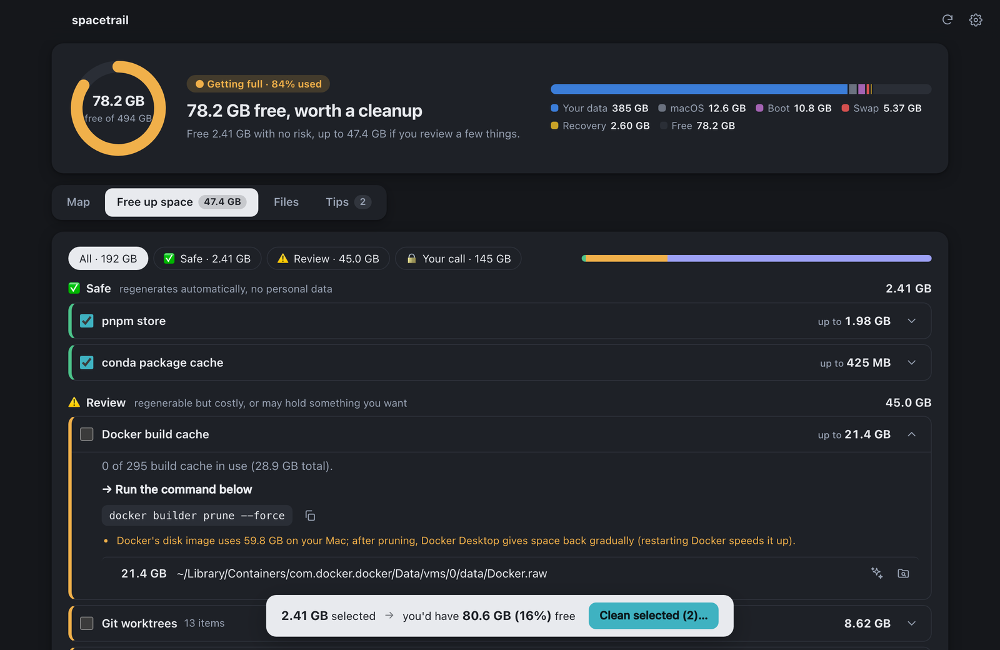
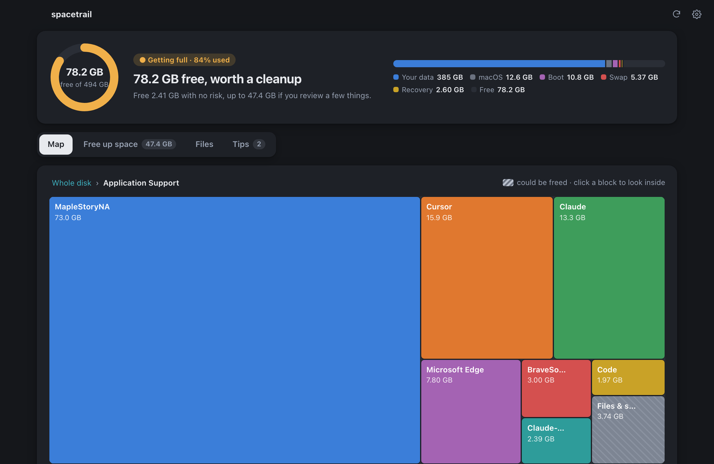
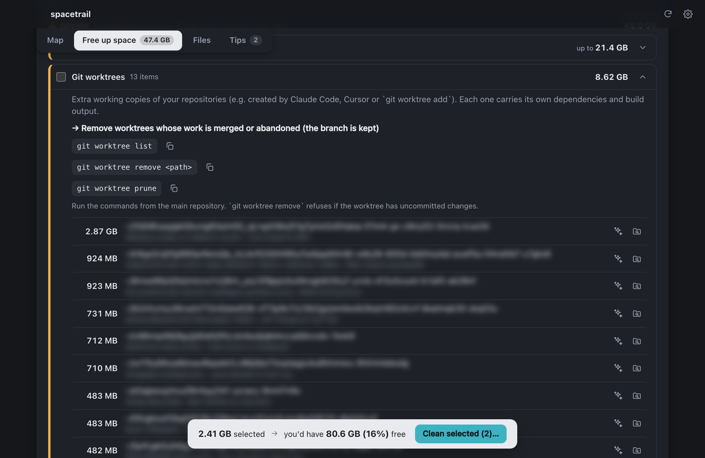
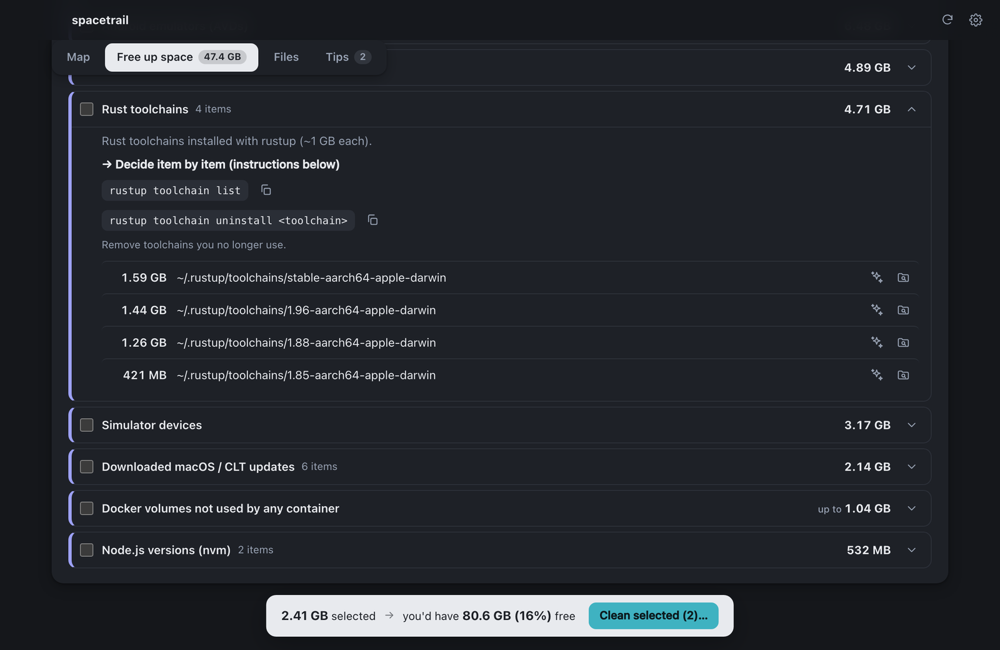
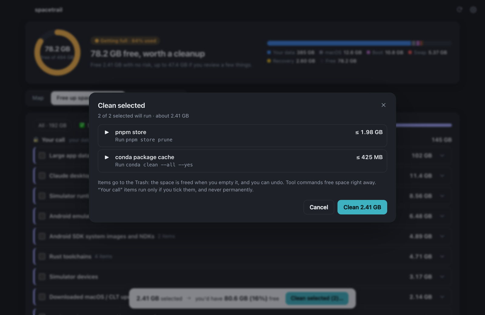
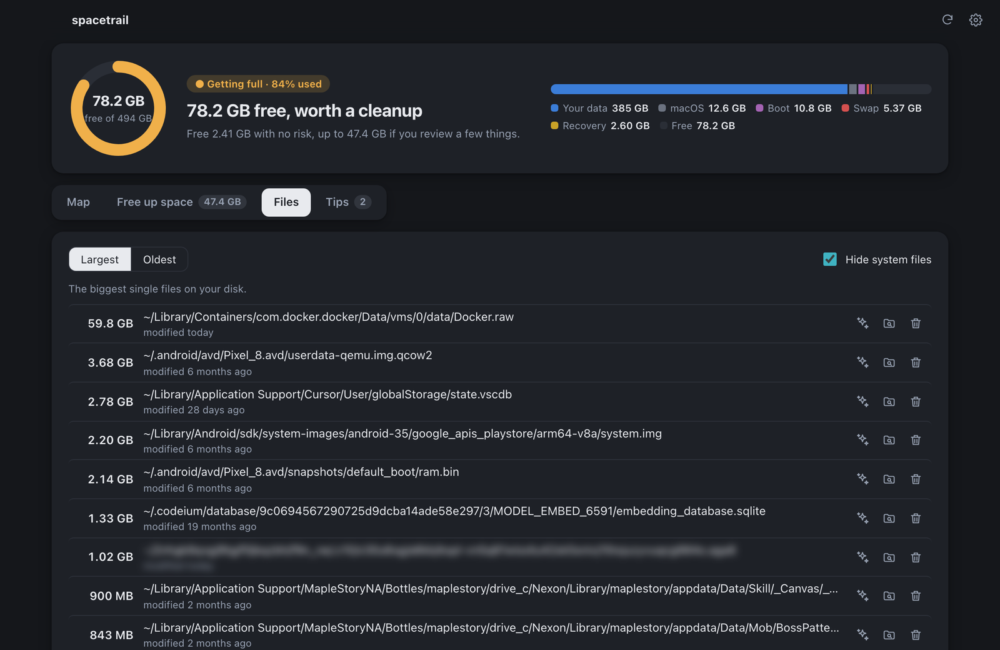
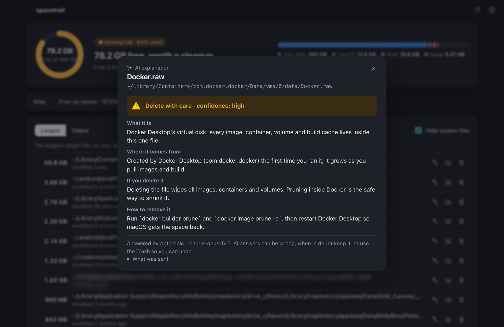
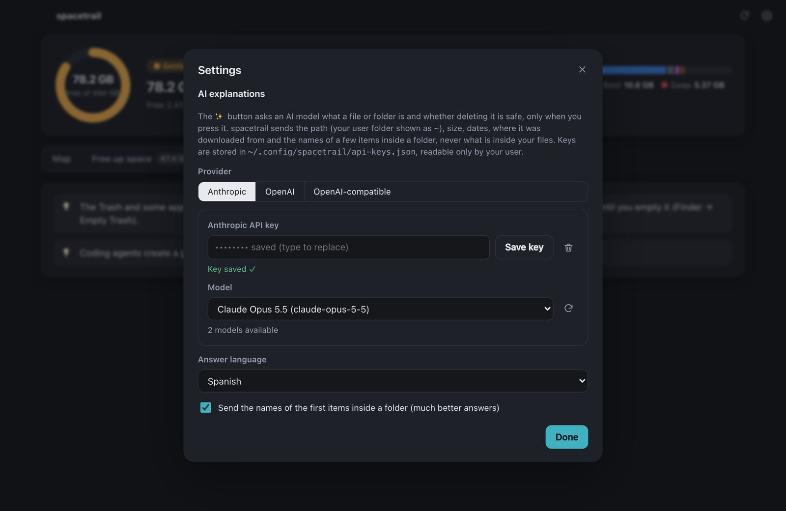
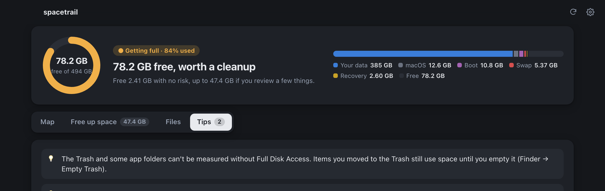
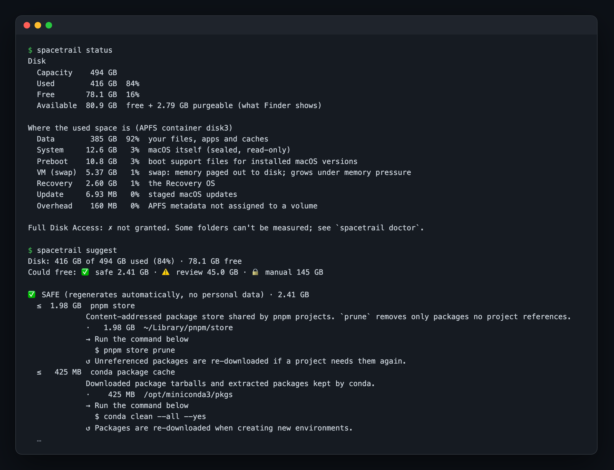

<div align="center">


# spacetrail

### Your Mac says "disk almost full". spacetrail tells you *why*, and gets the space back safely.

**Native macOS disk explorer and cleaner, written in Rust.** It shows where every gigabyte went, explains what each file is, and frees space with one click. Everything goes to the Trash, so you can always undo.

[](https://github.com/tonyalcast/spacetrail/actions/workflows/ci.yml)




</div>

---

## Why spacetrail?

You open *About This Mac → Storage* and see a giant gray bar called **"System Data"**. Finder can't open it. Cleaner apps want a subscription, a full-disk scan uploaded somewhere, and your trust that "Junk: 38 GB" is really junk.

spacetrail does it differently:

- 🔍 **It shows you everything.** It measures the whole disk in seconds and draws it as a map you can click into.
- 🧠 **It explains, not just lists.** For every suggestion you get what it is, what happens if you remove it, what comes back on its own, and the exact command to do it.
- 🛡️ **It's safe by default.** Nothing is deleted without your say. Items go to the Trash, every action is logged, and you get an **Undo** button.
- 🔒 **It's private.** No account, no telemetry, no cloud. The CLI and libraries never touch the network.
- 👩‍💻 **It knows developer Macs.** Docker disks, Xcode DerivedData, simulators, `node_modules`, Rust toolchains, Ollama models, git worktrees left by coding agents. That's where the space usually goes.

---

## ✨ Features

### 🗺️ See your whole disk at a glance

A treemap of the whole disk. Click any block to go inside. Striped areas are space you could free. The header gives the real numbers per APFS volume (your data, macOS, swap, preboot, recovery), so "System Data" stops being a mystery.



### 🧹 Free up space, grouped by risk

**62 built-in cleaner rules** plus smart detectors find what you can remove. Each one is labeled with an icon *and* a word, never color alone:

| | Level | What it means |
|---|---|---|
| ✅ | **Safe** | Regenerates automatically, no personal data. Caches, logs, package stores. |
| ⚠️ | **Review** | Regenerable but costly to rebuild, or may hold something you want. Docker build cache, worktrees, browser caches. |
| 🔒 | **Your call** | Your data or expensive assets. Never removed in bulk, only items you tick one by one. |

Tick what you want and a live **what-if simulator** tells you how much free space you'll end up with before you touch anything.



### 🔐 "Your call" items, removed the right way

For expensive assets, spacetrail uses the tool's own uninstaller instead of yanking folders out from under it: `rustup toolchain uninstall`, `ollama rm`, `xcrun simctl runtime delete`, `hf cache rm`, `docker volume prune`. Your default toolchain or Node version is **protected** and is never offered.



### ✅ One click, with a plan first

**Clean selected** shows exactly what will run (Trash moves or tool commands), then runs it with progress, results, **Retry** for anything that failed, and **Undo** for everything that went to the Trash.



### 📂 Largest and oldest files

The files eating the most space, and the big ones you haven't touched in years. A *Hide system files* filter keeps the list to things you actually manage. Every row can **Explain**, **Show in Finder**, or **Move to Trash**.



### 🤖 "What is this file?" Ask AI

Not sure what `Docker.raw` or some 9 GB folder in `Application Support` is? Press ✨ and your chosen model (Anthropic, OpenAI, or any OpenAI-compatible server such as Ollama or LM Studio) tells you where it comes from, whether it's safe to delete and what would break.

- Sends **metadata only**: path (home shown as `~`), size, dates, download origin. **Never file contents.**
- Shows you **exactly what was sent**.
- Runs only when you press the button. Your API key lives in an owner-only file (`chmod 600`).



<details>
<summary><b>Settings: pick your provider, model and answer language</b></summary>
<br>

</details>

### 💡 Tips that actually matter

Advice from what was found, such as swap growing under memory pressure, a Trash that still holds gigabytes, or worktrees piling up.



### ⌨️ A real CLI, too

Everything the app knows is available in the terminal, read-only, scriptable, with **stable `--json` output** on every command and `NO_COLOR` support.



```bash
spacetrail status     # capacity and where the used space lives (per APFS volume)
spacetrail top        # largest folders and files (whole disk by default)
spacetrail suggest    # what you can delete, grouped by risk, with how-to
spacetrail doctor     # Full Disk Access and environment checks
spacetrail scan PATH  # summarize any folder
```

Sizes default to decimal units, matching Finder. Add `--binary` for GiB.

---

## 🛡️ Built to be trusted

Deleting files is serious. spacetrail is built so that bugs can't easily turn into data loss:

- **One executor.** All deletions go through a single audited module. Process spawning and deletion APIs are **banned by lint** everywhere else, and CI enforces it (`cargo xtask check-safety`).
- **Checked twice.** Protected and system locations, symlinks (never followed), mount points, app bundles and cloud-only files are checked when the plan is made **and again** right before each move, to rule out time-of-check/time-of-use races.
- **Trash + journal + undo.** Every move is recorded in a JSON-lines journal and can be restored.
- **Cloud files stay in the cloud.** iCloud/Dropbox placeholders are only `lstat`-ed, never opened, so nothing gets downloaded.
- **Unknown is never zero.** Folders it can't read are reported as *unknown size*, not silently counted as empty.
- **No root, ever.** Full Disk Access is granted to the app only, not to your terminal.
- **Commands are argv arrays, not shell strings.** They run with a minimal environment and a time limit. Community cleaners can't run commands unless you opt in for each one.

---

## 🚀 Getting started

> 🚧 **Early development.** The CLI and desktop app work today on the author's machine. Signed releases are coming. For now, build from source.

**Requirements:** macOS (Apple Silicon or Intel), Rust 1.88+ (`rustup` picks the right toolchain from `rust-toolchain.toml`).

```bash
git clone https://github.com/tonyalcast/spacetrail.git
cd spacetrail
cargo run -p spacetrail-cli --release -- status
```

### Desktop app

```bash
cargo install tauri-cli --version "^2"
cd apps/desktop && cargo tauri build   # → target/release/bundle/macos/spacetrail.app
```

The build signs the app with a code-signing identity called `spacetrail-dev` from your login keychain. To create it, open *Keychain Access → Certificate Assistant → Create a Certificate…* and choose type **Code Signing**. A stable signature lets macOS keep the app's Full Disk Access across rebuilds.

On first launch, spacetrail walks you through granting Full Disk Access in System Settings and detects when you've done it.

---

## 🧩 Add your own cleaners

Cleaners are simple TOML files. Drop yours in `~/.config/spacetrail/cleaners/` and spacetrail picks them up:

```toml
schema = 1
id = "my-tool-cache"
version = "1.0.0"
name = "MyTool cache"
description = "Downloaded artifacts kept by MyTool."
risk = "safe"
risk_reason = "Re-downloaded automatically when needed."
category = "developer/other"
regenerates = "On the next MyTool run."

[measure]
paths = ["~/Library/Caches/MyTool"]

[[action]]
type = "trash"
```

See [`docs/CLEANER_SPEC.md`](docs/CLEANER_SPEC.md) for the full format, and the [`cleaners/`](cleaners) folder for 62 real examples covering editors, JS, Python, Go, Rust, .NET, JVM, Xcode, Android, AI models, browsers and chat apps.

---

## 🏗️ Architecture

A Rust workspace with strict crate boundaries:

| Crate | Role |
|---|---|
| `spacetrail-core` | Platform-agnostic model, parallel walker, diff, formatting. No `unsafe`. |
| `spacetrail-macos` | All FFI: APFS, statfs, firmlinks, Full Disk Access probe, Trash. |
| `spacetrail-cleaners` | Cleaner schema, planner and the **single executor**. |
| `spacetrail-store` | The only crate that talks SQL (history). |
| `spacetrail-cli` | The `spacetrail` binary. |
| `apps/desktop` | Tauri desktop app. The only component allowed to use the network, and only for ✨ Explain. |

More in [`docs/ARCHITECTURE.md`](docs/ARCHITECTURE.md). The roadmap (storage history, growth attribution, "who is writing right now", menu bar alerts) is in [`docs/PLAN.md`](docs/PLAN.md).

---

## 🤝 Contributing

Issues and pull requests are welcome, especially **new cleaner rules** for tools you use. Before opening a PR:

```bash
cargo fmt --all
cargo clippy --workspace --all-targets -- -D warnings
cargo test --workspace
cargo xtask check-safety
```

Tests never touch your real home folder. They run in a temporary `SPACETRAIL_HOME`.

---

## 📄 License

Dual-licensed under [MIT](LICENSE-MIT) or [Apache 2.0](LICENSE-APACHE), at your option.

<div align="center">
<br>
<b>Stop guessing what "System Data" is.</b><br>
⭐ Star the repo if spacetrail got you some space back.
</div>
